<p align="center">
  
</p>

<h1 align="center">Hub and Disc Assembly SPM — PC Software (Machine 2)</h1>

This project is **live** in Ashok Leyland, a $ 5 bn automotive company in India, and is being used on 2 machines which
assemble the hub, knuckle, and bearings for the front axles of 2 LCV models – DOST and DOSTPLUS. The assembly process
has intermixed automated activities and manual activities. The challenge was to ensure that the manual activities are
checked and ratified in real-time with vision checks. I wrote the software that interacts with the machine and ensures
that every step in the defined process is adhered to.

On one machine, the software interlocks with an Allen-Bradley PLC (Micro 850) and on the other with a Siemens PLC
(S7-1515).

**The software has 8 processes** – an IO Server, a Front End Server, a Database Server, a QRCode Scanning Server, a
Logging Server, a Heartbeat Monitoring Server, a Camera & Image Processing Server, and the Main Program – which interact
with each other over Redis to exchange messages and keep the process ensemble in sync with respect to the current
Machine State.

<p align="center">
  <b>CosTheta Technologies</b> · Python 3.12 · PySide6 · Redis · PostgreSQL · YOLO + MobileSAM · Siemens S7-1515 / Allen-Bradley Micro-850
</p>

---

## Contents

1. [What it does](#1-what-it-does)
2. [System at a glance](#2-system-at-a-glance)
3. [The eight processes](#3-the-eight-processes)
4. [How the processes talk](#4-how-the-processes-talk)
5. [The 28-state assembly cycle](#5-the-28-state-assembly-cycle)
6. [A vision check, end to end](#6-a-vision-check-end-to-end)
7. [The vision checks](#7-the-vision-checks)
8. [Configuration](#8-configuration)
9. [Build, deploy, run](#9-build-deploy-run)
10. [Dry runs and studies](#10-dry-runs-and-studies)
11. [Repository layout](#11-repository-layout)
12. [Documentation map](#12-documentation-map)

---

## 1. What it does

The machine is a special-purpose assembly station. **The PLC runs the machine; this PC software sees, decides and records.**
For every component the PC:

| Step | What the PC does |
|---|---|
| Identify | reads the component's QR code (serial scanner), checks it is valid and not a duplicate |
| Configure | writes the side (LHS / RHS), model (DOST / DOST+) and the cycle settings from `machine_settings` to the PLC |
| Inspect | answers each of the PLC's vision-check requests from a camera picture — knuckle, hub + bottom bearing, top bearing, nut + plate washer, bung, no-bung, split pin + washer, cap |
| Measure | records the tightening and free-rotation torques and the press events (OK / NOT OK is the PLC's decision) |
| Show | gives the operator a live screen in English, Kannada, Tamil or Hindi, with every picture and result |
| Store | writes one database row per component (PostgreSQL), with a FIFO that survives a database outage |

One code base serves both machines; the only build-time difference is `plc.vendor`.

| | Machine 1 | Machine 2 |
|---|---|---|
| PLC | Allen-Bradley Micro 850 (pycomm3) | Siemens S7-1515 (pyS7) |
| Properties prefix | `allenbradley.` | `siemens.` |
| Build | `runNuitka.bat allenbradley` | `runNuitka.bat siemens` |

<p align="center">
  
  
  <br><i>The machine sequence (docs/machine2-sequence.md)</i>
</p>

---

## 2. System at a glance

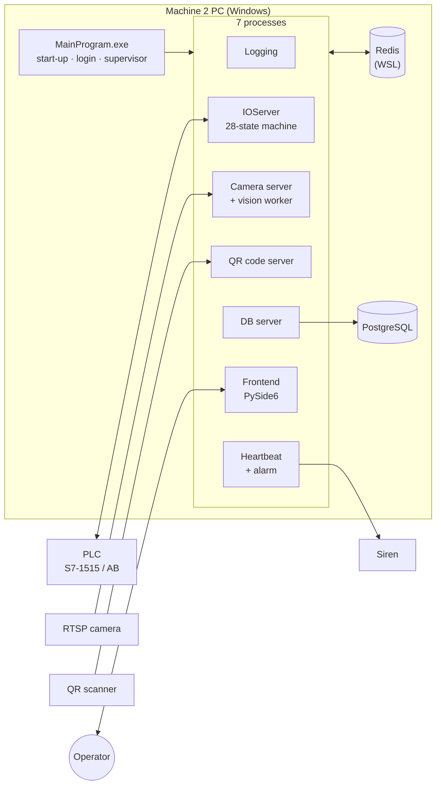

<p align="center">
  <br>
  <i>Full runtime topology (docs/code_graph/1_runtime.svg)</i>
</p>

---

## 3. The eight processes

`MainProgram.py` checks the model files and Redis, backs up the database (in a thread, beside the mode and login dialogs),
then starts seven server processes under `utils/ProcessSupervisor.py`, which restarts any that dies (rate-limited);
the Main Program itself is the eighth.

| # | Process | Module | Job |
|---|---|---|---|
| P0 | Main Program | `MainProgram.py` | start-up checks, database backup, mode and login, starts and supervises the others |
| P1 | Logging | `logutils` | central file and console logs |
| P2 | Camera server | `camera/CameraProcessorServer.py` | RTSP pictures; every vision check runs in a `VisionCheckWorker` child process with a 12 s deadline |
| P3 | QR code server | `costhetaio/qrcodescanner/QRCodeScanningServer.py` | reads and validates the component QR code |
| P4 | IOServer | `costhetaio/commonplc/PLCIOServer.py` | the 28-state cycle; every PLC read / write; the reset rule |
| P5 | DB server | `persistence/DBServer.py` | one row per component; FIFO with acknowledgement |
| P6 | Frontend | `frontend/AshokLeylandFrontEnd.py` | operator screen, settings, reports, four languages |
| P7 | Heartbeat + alarm | `monitorAllConnections/HeartbeatAndAlarmServer.py` | liveness of every server; siren |

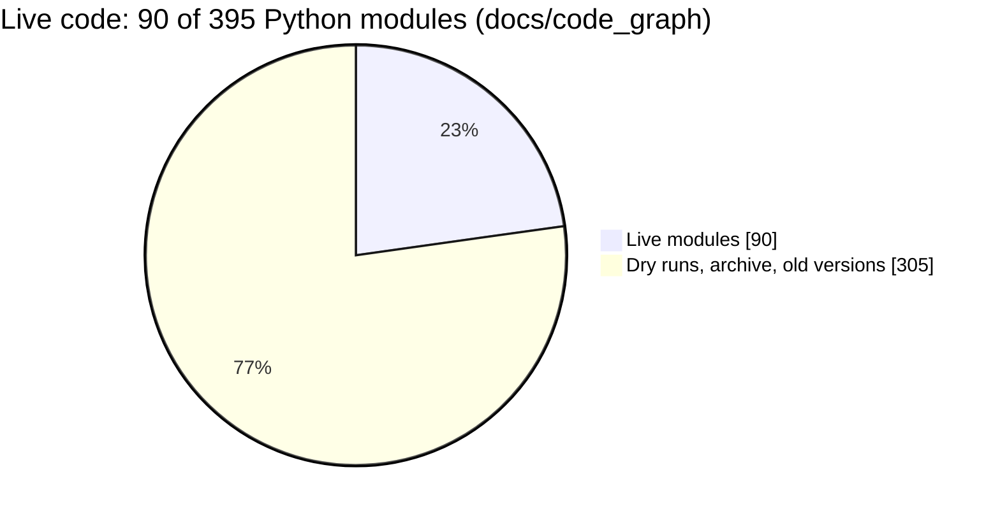

---

## 4. How the processes talk

**Redis is used only between processes** — streams with one producer and one consumer (except `alarm.q`), plus a few
keys. Data used inside one process stays in memory. Every queue has a `send<What>From<A>To<B>` /
`read<What>In<B>From<A>` pair in `utils/RedisUtils.py`.

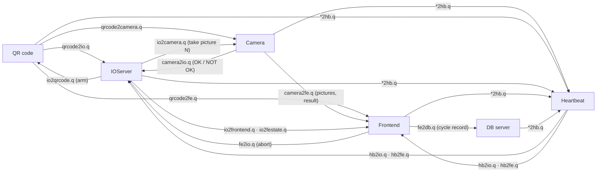

<p align="center">
  <br>
  <i>Every stream and key with its writer and reader (docs/code_graph/2_redis.svg)</i>
</p>

---

## 5. The 28-state assembly cycle

The IOServer walks the PLC through 28 states. Each vision state is a *read* (the PLC asks, the PC answers from a picture)
and a *write* (the result back to the PLC). A NOT OK sends the cycle back to the same read for a retake.

```mermaid
stateDiagram-v2
  direction LR
  [*] --> QR
  QR: 1-2 QR code, settings to PLC
  KN: 3-4 Knuckle
  HUB: 5-6 Hub + bottom bearing
  TB: 7-8 Top bearing
  NUT: 9-10 Nut + plate washer
  T1: 11-12 Tightening torque 1
  B1: 13-14 Bung (component press)
  CP: 15 Component press
  NB: 16-17 No bung
  T2: 18-19 Tightening torque 2
  SP: 20-21 Split pin + washer
  CAP: 22-23 Cap
  B2: 24-25 Bung (cap press)
  CPR: 26 Cap press
  FR: 27-28 Free rotation torque
  QR --> KN
  KN --> HUB
  HUB --> TB
  TB --> NUT
  NUT --> T1
  T1 --> B1
  B1 --> CP
  CP --> NB
  NB --> T2
  T2 --> SP
  SP --> CAP
  CAP --> B2
  B2 --> CPR
  CPR --> FR
  FR --> [*]
  T1 --> SP: Skip second tightening
  KN --> KN: NOT OK
  HUB --> HUB: NOT OK
  SP --> SP: NOT OK
```

**Reset rule.** At start, at cycle end and on every abort, one routine resets every per-cycle tag (not the settings) with
retries and read-back, then arms `PLC_PC_CheckQRCode`. After a lost PLC connection the IOServer decides from the PLC's
own tags whether the PLC restarted (reset) or not (carry on). The handshake itself is fixed by the PLC design —
see [`docs/PLC_Interface_Spec.md`](docs/PLC_Interface_Spec.md).

<p align="center">
  <br>
  <i>All 28 states and their transitions (docs/code_graph/5_cycle.svg)</i>
</p>

---

## 6. A vision check, end to end

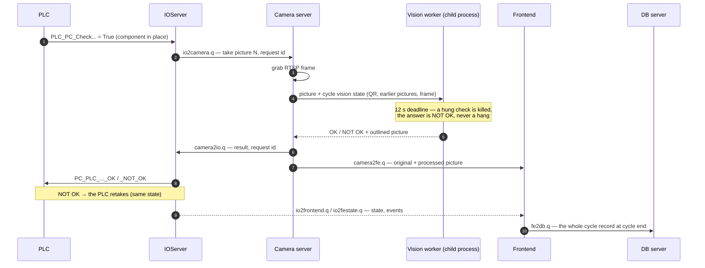

The camera server keeps the cycle's vision state in `ImageProcessor` and writes it to
`Temp/camera_server_state.pkl`, so a restarted camera server carries on with the same cycle.

---

## 7. The vision checks

<p align="center">
  <br>
  <i>Camera server, worker and the dependencies between checks (docs/code_graph/3_camera.svg)</i>
</p>

| State | Check | Method (in short) |
|---|---|---|
| 3 | Knuckle | segmentation of the knuckle + the knuckle frame (position reference for later checks) |
| 5 | Hub + bottom bearing | `checkHub()`: YOLO + MobileSAM masks in an annulus, grouped by distance and size, equally spaced sets of 4 (DOST) / 5 (DOST+) holes or bolts |
| 7 | Top bearing | ring segmentation and diameter limits |
| 9 | Nut + plate washer | nut and washer diameters, washer colour |
| 13 / 24 | Bung | the bung's own hole pattern + seated position from the hub's holes (strict — a 2.5 t press follows) |
| 16 | No bung | the nut seen without a bung |
| 20 | Split pin + washer | washer found round the expected centre (hub holes + offset), legs must not stand out past the washer |
| 22 | Cap | cap mask, seating by its distance from the hub centre |

Pictures sent to the operator carry **outlines only** — green OK, red NOT OK. Values and reasons go to the log.

### 7.1 Hub holes — the common reference for cap, bung and split pin

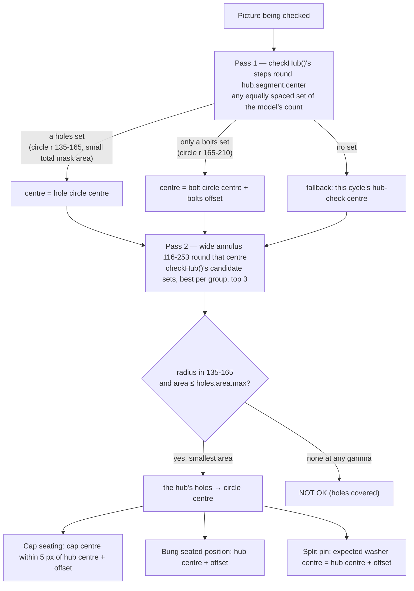

`camera/FindHubHoles.py` re-uses `checkHub()`'s own methods on a per-thread object; `checkHub()` itself is never changed.
Taking the centre from the picture being checked (CHANGES 182) removed the failures caused by a hub-check centre taken
from another part.

### 7.2 Split pin — the study in progress

The production check (CHANGES 162 / 163) finds the washer and NOT-OKs a blue-marked leg that stands out past it. A new
check is being studied in `test/machine2_dryrun` with **red-marked legs** and with **no colour at all**:

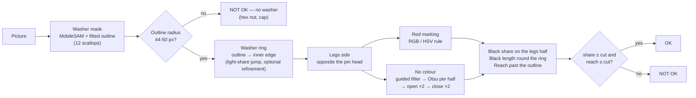

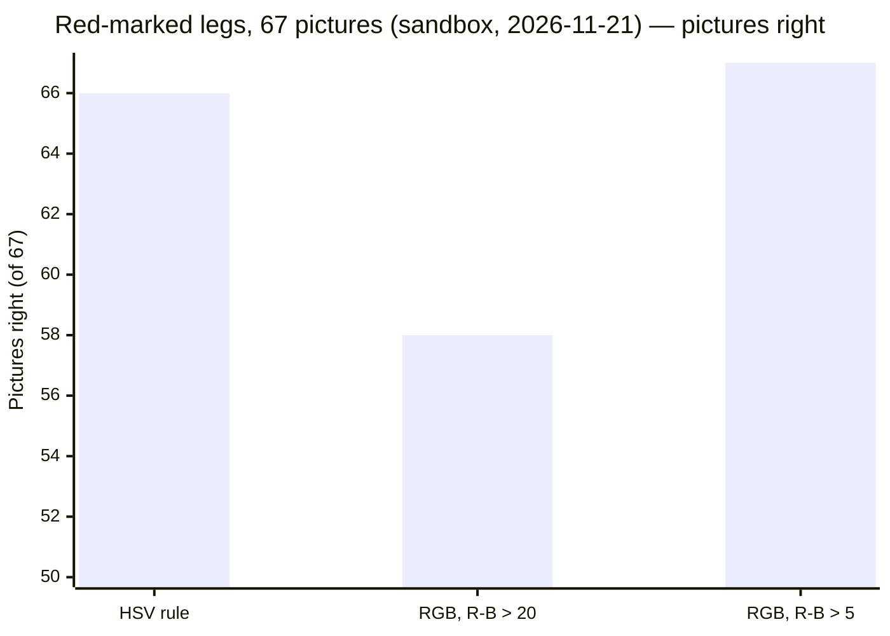

<sub>Rules: black share on the legs half ≥ cut and reach past the outline ≤ cut, cut-offs fitted on the same pictures;
one OK part had its paint pressed off by the pliers. Details in `CHANGES_MACHINE2.md` §192 - 194.</sub>

---

## 8. Configuration

| File | What |
|---|---|
| `ApplicationConfiguration.properties` | the live file (= the Machine 2 copy) — **kept local, not in git** |
| `ApplicationConfiguration.Machine1.properties` / `.Machine2.properties` | build copies; differ only in `plc.vendor` — **local, not in git** |
| `ApplicationConfiguration*.example.properties` | the sanitised copies in git: copy one to the real name and fill in the credentials |
| `costhetaio/siemens/IOServerProperties.yaml` | Siemens rack / slot / PDU, tag addresses |

```bat
:: first checkout on a new machine
copy ApplicationConfiguration.example.properties ApplicationConfiguration.properties
copy ApplicationConfiguration.Machine1.example.properties ApplicationConfiguration.Machine1.properties
copy ApplicationConfiguration.Machine2.example.properties ApplicationConfiguration.Machine2.properties
:: then put in the camera, PostgreSQL and mail credentials
```

- **Vision values** — `<vendor>.vision.*`, declared in each check through `camera/VisionConfig.py` (`vInt`, `vFloat`,
  `vTuple`, …). A change of a check's *logic* needs a reference commit, proved by
  `test/machine*_dryrun/Verify_Vision_Config_Equivalence.py` ("ALL EQUIVALENT").
- **Tuning values** — retry counts, timeouts, ports, font sizes: plain keys through `CosThetaConfigurator.getTuning()`;
  `DryRun_Tuning_Keys.py` checks the code defaults equal the properties.
- A missing or invalid key is logged once (`[Configuration] …`) and the default used.
- `cycle.settings.source=database`: the state-2 settings come from `machine_settings`, per model.

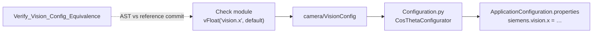

---

## 9. Build, deploy, run

| Where | What |
|---|---|
| Laptop `C:\PythonProjects\AshokLeyland_Machine2` | the repo, the models, the dry runs; builds the exe |
| Machine 2 PC `D:\AshokLeyland\MainProgram.dist\MainProgram.exe` | the exe only; started at logon; Redis in WSL; PostgreSQL; NVIDIA GPU |

```bat
:: laptop
cd C:\PythonProjects\AshokLeyland_Machine2
git pull origin main
.\runNuitka.bat siemens
:: copy MainProgram.dist to D:\AshokLeyland on the Machine 2 PC
```

- `models/` (YOLO + MobileSAM weights, ~5.8 GB) is not in git and not in the exe. At start `utils/ModelsCheck.py` checks
  every file in `models.required.files` exists with its expected size; otherwise a message is shown for 5 s and the
  program exits before anything starts.
- The plant PC start-up: `Start-Hub-And-Disc-application - Production.vbs` (logon) → `Startup.bat` → `MainProgram.exe`.
- Verification steps for a new exe on the plant PC: [`docs/plant-pc-verification.md`](docs/plant-pc-verification.md).

---

## 10. Dry runs and studies

Synthetic dry runs live in **both** `test/machine1_dryrun` and `test/machine2_dryrun` (identical apart from paths) and are
listed with what they check in their `README.md`. They need Redis on `localhost:6379`; the database ones PostgreSQL on
`127.0.0.1:5432`.

```bat
python test\machine2_dryrun\Verify_Vision_Config_Equivalence.py
python test\machine2_dryrun\DryRun_IOServer_Fault_Scenarios.py
python test\machine2_dryrun\DryRun_SplitPin_Check_UI.py --auto
python test\machine2_dryrun\DryRun_Hub_Holes_SAM.py --wrong-model
python test\machine2_dryrun\DryRun_Hub_Holes_Centre_Source.py
python test\machine2_dryrun\DryRun_All_Checks_UI.py
```

Split pin studies (window, or `--auto <folder>` with `OK\` and `NOT_OK\` sub-folders):

| Script | Studies |
|---|---|
| `Study_Washer_SAM_UI.py` | washer and legs by MobileSAM (profiles, centres, coverage) |
| `Study_Legs_Length_UI.py` | legs as a skeleton length over the washer; Otsu / closing dropdowns |
| `Study_Red_Legs_UI.py` | legs by their red marking; RGB / HSV rule; guided / bilateral pipelines |
| `Study_NoColour_Legs_UI.py` | the filtered pipeline with no colour at all |

```bat
python test\machine2_dryrun\Study_Red_Legs_UI.py --model DOSTPLUS
python test\machine2_dryrun\Study_NoColour_Legs_UI.py --auto "C:\path\to\pictures" --model DOSTPLUS
```

---

## 11. Repository layout

```
MainProgram.py              start-up, login, process supervisor
Configuration.py            CosThetaConfigurator (properties, tuning, vision keys)
camera/                     camera server, vision worker, every vision check, FindHubHoles, VisionConfig
costhetaio/                 IOServer (commonplc), Siemens / Allen-Bradley PLC layers, QR code server
frontend/                   PySide6 operator screen, dialogs, languages, Qt message handler
persistence/                DB server, PostgreSQL access, FIFO of failed records
monitorAllConnections/      heartbeat and alarm server
utils/                      RedisUtils, ProcessSupervisor, ModelsCheck, CameraReboot, image utilities
endpoints/                  OtherServices: web service, dashboard, screen share
Internal/locale/            Kannada, Tamil, Hindi catalogues (.po / .mo)
test/machine1_dryrun/       dry runs and studies (Machine 1 settings)
test/machine2_dryrun/       dry runs and studies (Machine 2 settings)
docs/                       HLD, LLD, PLC interface, state sync, plant verification, code graphs
archive/                    old versions, kept for reference
```

<p align="center">
  <br>
  <i>Import graph of the 90 live modules (docs/code_graph/6_modules.svg)</i>
</p>

---

## 12. Documentation map

| Document | Read it for |
|---|---|
| [`CLAUDE.md`](CLAUDE.md) | working notes: rules for changing code, open items, how the work is done |
| [`docs/code_graph/CODE_GRAPH.md`](docs/code_graph/CODE_GRAPH.md) | **read before changing code** — the graphs of the live code |
| [`docs/HLD.md`](docs/HLD.md) | high-level design, every Redis queue and key |
| [`docs/LLD.md`](docs/LLD.md) | low-level design of each process and check |
| [`docs/PLC_Interface_Spec.md`](docs/PLC_Interface_Spec.md) | the PC ↔ PLC tags and handshake |
| [`docs/state_sync.md`](docs/state_sync.md) | one source of truth for the cycle state (Plan A / B) |
| [`docs/plant-pc-verification.md`](docs/plant-pc-verification.md) | what to verify on the plant PC after a new build |
| [`docs/vision_positions_machine2.md`](docs/vision_positions_machine2.md) | Machine 2 vision positions and values |
| [`CHANGES_MACHINE2.md`](CHANGES_MACHINE2.md) | the numbered history of every change (§1 - §200) |

---

<p align="center"><sub>© CosTheta Technologies, Bengaluru — private repository for Ashok Leyland Machine 1 / Machine 2.</sub></p>
