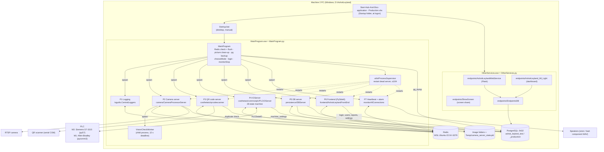
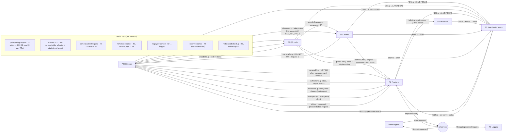
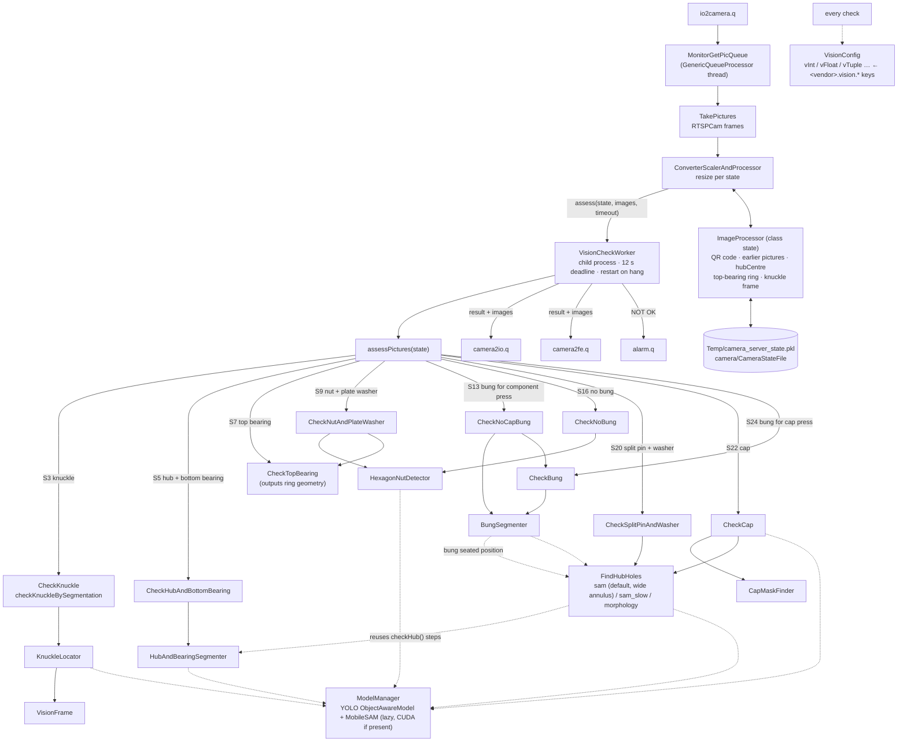
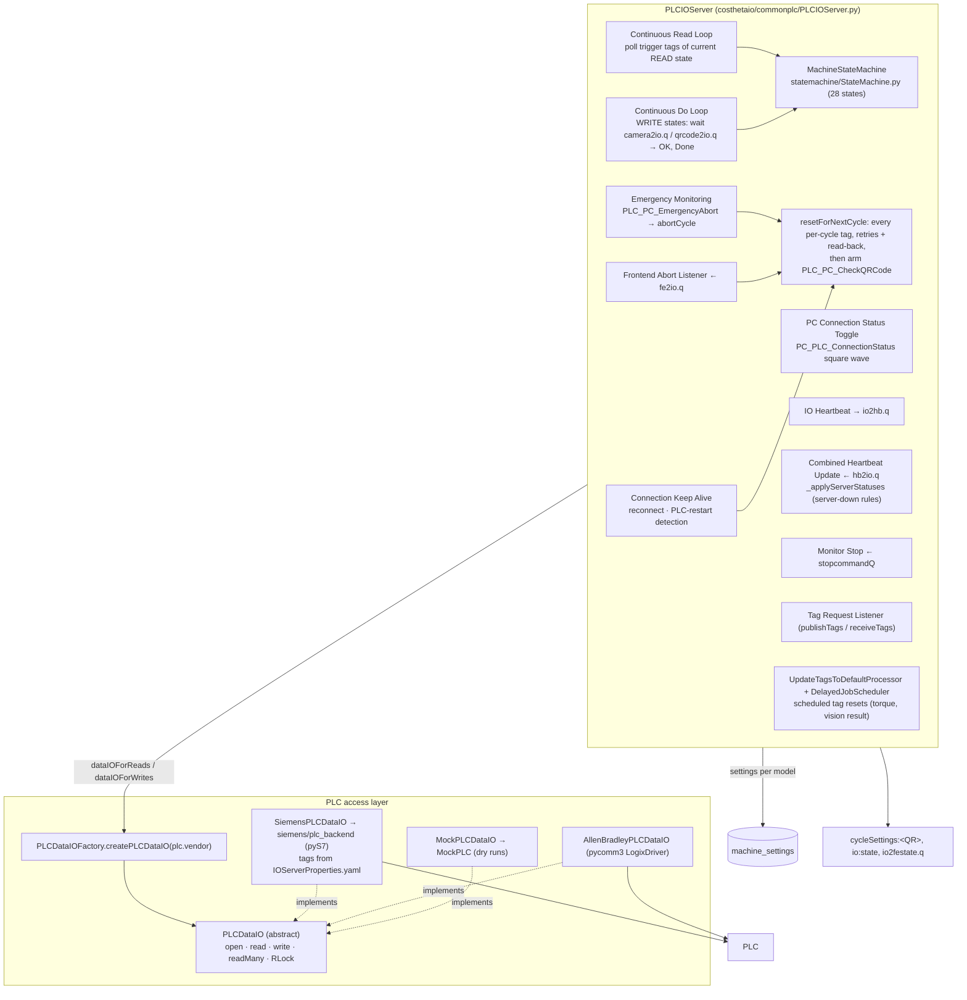

<!-- Generated by docs/code_graph/tools/build_doc.py from CODE_GRAPH.src.md and *.mmd; edit those. -->
# Code graph — AshokLeyland Machine 2

**Must read before changing code.** Traced from branch `machine2-io-fe-db-cam` at commit `a33aad1` (2026-11-19,
CHANGES 167). Built from the code itself (AST import walk from the two entry points, and a scan of every
`send…` / `read…` call in `utils/RedisUtils.py`), then checked against `docs/HLD.md` §3–5 and `docs/LLD.md`.

Each diagram is below as Mermaid (GitHub renders it) and as an SVG in this folder (`docs/code_graph/*.svg`) for
zooming. The `.mmd` files are the sources.

| # | Diagram | Answers |
|---|---|---|
| 1 | Runtime topology | What starts what, which process touches which device / store |
| 2 | Redis wiring | Who sends what to whom (every stream and key) |
| 3 | Camera server and vision checks | Picture request → worker → which check, and what each check depends on |
| 4 | IOServer internals | The threads, the reset routine, the PLC access layer |
| 5 | Cycle state machine | The 28 states, retakes, the bypass |
| 6 | Module import graph | Every live module and its local imports |

## 0. Live code vs the rest

- **Entry points:** `MainProgram.py` (the station; built to `MainProgram.exe`) and `OtherServices.py` (web service, MI
  dashboard, screen share; built to `OtherServices.exe`). Both are started by
  `Start-Hub-And-Disc-application - Production.vbs`.
- **Live:** 87 of 379 Python modules are reachable from those two (imports at module level and inside functions).
- **Not reachable (292):** `test/machine2_dryrun` 68, `test/machine1_dryrun` 64, `archive/` 49, other `test/` 42,
  leftovers in `frontend/` (old widgets), `costhetaio/` (`IOServer_ModbusTCP.py`, `siemens/test`), `processors/`,
  `utils/`, `video/`, `camera/` (`CameraRecorderServer`, `HandDetector`, `VideoCamera`, `ONVIFCam`, `PhotoCamera`),
  `mail/`, root scripts (`main.py`, `definition.py`, `VerifyIntegrity.py`, `test-*.py`, `verify_installation.py`).
  Not reachable ≠ delete: the dry runs and several kept methods are deliberate (CLAUDE.md §5).

**Hub modules** — imported almost everywhere, so they are left out of diagram 6 to keep it readable:

| Module | Imported by (live modules) | Lines | Role |
|---|---|---|---|
| `Configuration` | 46 | 3,568 | `CosThetaConfigurator` singleton: properties file, `getTuning`, vendor prefixes |
| `BaseUtils` | 31 | 557 | Shared helpers |
| `logutils.SlaveLoggers` / `logutils.Logger` | 30 / 29 | 235 / 157 | Per-process loggers that push to the logging server through Redis |
| `utils.RedisUtils` | 21 | 2,898 | **All** inter-process messaging: `send<What>From<A>To<B>` / `read<What>In<B>From<A>`, queue names, keys |
| `utils.SuppressedExceptions` | 18 | 64 | Logged exception swallowing |
| `utils.CosThetaPrintUtils` | 16 | 255 | Coloured console output |
| `camera.VisionConfig` | 15 | 299 | `vInt` / `vFloat` / `vTuple` / `vPoints` ← `<vendor>.vision.*` keys |
| `utils.QRCodeHelper` | 13 | 106 | QR parsing, model / side / tonnage mapping |
| `logutils.LogSettings` | 11 | 211 | Log levels and process names |
| `utils.CosThetaFileUtils` | 10 | 422 | Paths and folders |
| `statemachine.StateMachine` | 6 | 260 | `MachineState` (28 states) and `MachineStateMachine` |
| `processors.GenericQueueProcessor` | 4 servers | 241 | Base class of the server threads (stop-queue polling) |

Largest live files: `HubAndBearingSegmenter` 3,734 · `PLCIOServer` 3,323 · `HexagonNutDetector` 2,952 ·
`Persistence` 2,985 · `RedisUtils` 2,898 · `utils.ImageNormalisationWithMask` 2,659 · `AshokLeylandFrontEnd` 2,453 ·
`CheckTopBearing` 2,216 · `BungSegmenter` 2,048 · `SimplePopups` 2,025.

## 1. Runtime topology



SVG: [`1_runtime.svg`](1_runtime.svg)

- MainProgram start order: logging → (backup, mode, login) → camera, QR, IO, frontend, heartbeat, DB; then
  `ProcessSupervisor` watches them (every 2 s; at most 10 restarts per server per hour; nothing restarted once a stop
  command is on the stop queue). A restarted camera server reloads `Temp/camera_server_state.pkl`.
- Only the IOServer talks to the PLC; only the camera server to the camera; only the QR server to the scanner.
- The DB is touched by several processes (diagram), but **cycle records are written only by the DB server**, from
  `fe2db.q`.

## 2. Redis wiring



SVG: [`2_redis.svg`](2_redis.svg)

Derived from the call sites (comments ignored):

- One producer and one consumer per stream, except `alarm.q` (camera + QR) and `camera2fe.q`, which the **IOServer
  also writes** when the camera is down or misses its deadline (`PLCIOServer._pictureNotOkWithoutAnswer`, with a new
  request id so a late camera answer is not shown).
- `stopcommandQ` is sent by MainProgram and by the frontend (`FrontEndLogger`), read by every server (mostly through
  `GenericQueueProcessor`); `stoppedresponseQ` back from camera, IO, QR and DB (the DB server only after draining
  `fe2db.q`).
- `fe2db.q` is FIFO with explicit acknowledgement (`acknowledgeRecordInDatabaseServer`); the others are read as
  newest-message mailboxes.
- On abort, `clearKeyCommunicationQueuesOnAbort` (IO) clears `io2camera`, `io2qrcode`, `qrcode2io`, `qrcode2fe`,
  `qrcode2camera`, `camera2io`, `camera2fe`.
- `cycleSettings:<QR>` is written only by the IOServer (`publishCycleSettingsForQRCode`); the frontend and the DB
  server read it. (HLD §4.2 says "FE/IO" as writer.)
- `log:cycleContext` and `ioserver:started` are set outside `RedisUtils`; listed from HLD §4.2.

## 3. Camera server and vision checks



SVG: [`3_camera.svg`](3_camera.svg)

- Threads in `CameraProcessorServer`: `MonitorGetPicQueue` → `TakePictures` → `ConverterScalerAndProcessor`, each a
  `GenericQueueProcessor`. The check itself always runs in the `VisionCheckWorker` child process (no thread
  fallback since CHANGES 105); `assessPictures(state, images)` dispatches by `MachineState`.
- `S<n>` = Machine 2 state number of the READ state that asks for the picture.
- Cross-check coupling to know before editing:
  - `CheckNutAndPlateWasher` uses the top-bearing ring from `CheckTopBearing` (stored in `ImageProcessor`).
  - `CheckNoCapBung` imports `CheckBung`; both use `BungSegmenter`.
  - `FindHubHoles` (cap, bung, split pin) reuses `checkHub()`'s steps from `HubAndBearingSegmenter` on its own
    per-thread object — **do not change `checkHub()`** (CLAUDE.md §5). Its `sam` method (CHANGES 169) needs this
    cycle's hub-check centre (`ImageProcessor.hubCentre`, set by the hub check, read through `hubCentreProvider`).
  - Model users (`ModelManager`, lazy YOLO + MobileSAM): hub, nut / no-bung (`HexagonNutDetector`), knuckle locator,
    `FindHubHoles` (sam), cap.

## 4. IOServer internals



SVG: [`4_ioserver.svg`](4_ioserver.svg)

- Thread names as in the code (`threading.Thread(name=…)`): Continuous Read Loop, Continuous Do Loop, IOServer
  Connection Keep Alive, Emergency Monitoring, PC Connection Status Toggle, IO Heartbeat, Combined Heartbeat Update,
  Frontend Abort Listener, Monitor Stop, Tag Request Listener; plus `UpdateTagsToDefaultProcessor` and the
  `DelayedJobScheduler` for timed resets.
- Vendor chosen by `plc.vendor` through `PLCDataIOFactory`; Siemens addresses in
  `costhetaio/siemens/IOServerProperties.yaml`. Tags and timings: `docs/PLC_Interface_Spec.md` (fixed by the PLC
  design). Class detail: `docs/costhetaio_classes.svg`.

## 5. Cycle state machine (Machine 2, 28 states)

```mermaid
stateDiagram-v2
  direction LR
  [*] --> S1
  S1: 1 READ_QR_CODE (QR server)
  S2: 2 WRITE_QR_CODE (side, model, settings → PLC)
  S3: 3 read · knuckle
  S4: 4 write · knuckle
  S5: 5 read · hub + bottom bearing
  S6: 6 write · hub
  S7: 7 read · top bearing
  S8: 8 write · top bearing
  S9: 9 read · nut + plate washer
  S10: 10 write · nut + washer
  S11: 11 TIGHTENING_TORQUE_1_DONE
  S12: 12 TIGHTENING_TORQUE_1 (value)
  S13: 13 read · bung for component press
  S14: 14 write · bung
  S15: 15 COMPONENT_PRESS_DONE
  S16: 16 read · no bung
  S17: 17 write · no bung
  S18: 18 TIGHTENING_TORQUE_2_DONE
  S19: 19 TIGHTENING_TORQUE_2 (value)
  S20: 20 read · split pin + washer
  S21: 21 write · split pin
  S22: 22 read · cap
  S23: 23 write · cap
  S24: 24 read · bung for cap press
  S25: 25 write · bung
  S26: 26 CAP_PRESS_DONE
  S27: 27 FREE_ROTATION_TORQUE_1_DONE
  S28: 28 FREE_ROTATION_TORQUE_1 (value)
  S1 --> S2
  S2 --> S3
  S3 --> S4
  S4 --> S3: NOT OK (retake)
  S4 --> S5
  S5 --> S6
  S6 --> S5: NOT OK
  S6 --> S7
  S7 --> S8
  S8 --> S7: NOT OK
  S8 --> S9
  S9 --> S10
  S10 --> S9: NOT OK
  S10 --> S11
  S11 --> S12
  S12 --> S13
  S12 --> S20: Skip_Second_Tightening (bypass 13–19)
  S13 --> S14
  S14 --> S13: NOT OK
  S14 --> S15
  S15 --> S16
  S16 --> S17
  S17 --> S16: NOT OK
  S17 --> S18
  S18 --> S19
  S19 --> S20
  S20 --> S21
  S21 --> S20: NOT OK
  S21 --> S22
  S22 --> S23
  S23 --> S22: NOT OK
  S23 --> S24
  S24 --> S25
  S25 --> S24: NOT OK
  S25 --> S26
  S26 --> S27
  S27 --> S28
  S28 --> S1: cycle end → reset tags, arm QR, FE → fe2db.q
```



SVG: [`5_cycle.svg`](5_cycle.svg)

- READ states wait for a PLC trigger (or a value); WRITE states write the result handshake (`…OK`, then `…Done`).
- A vision NOT OK returns to the READ state and the PLC asks for a retake; the cycle never ends on a NOT OK.
- With `PC_PLC_Skip_Second_Tightening` written True in state 2, states 13–19 are skipped and recorded `Bypassed`.
- At state 28 → 1: reset every per-cycle tag (retries + read-back), arm `PLC_PC_CheckQRCode`, `END_OF_CYCLE` to the
  camera; the frontend sends the record on `fe2db.q`. The frontend keeps its own copy of the state machine; Plan A
  state sync compares it with `io2festate.q` (`docs/state_sync.md`).

## 6. Module import graph (live modules, hubs omitted)

Solid arrow = module-level import; dotted = import inside a function (lazy / process entry). Lines = file length.

```mermaid
flowchart LR
  subgraph pkg__root_["(root)"]
    MainProgram["MainProgram<br/><small>643 lines</small>"]
    OtherServices["OtherServices<br/><small>76 lines</small>"]
  end
  subgraph pkg_camera["camera"]
    camera_BungSegmenter["BungSegmenter<br/><small>2048 lines</small>"]
    camera_CameraProcessorServer["CameraProcessorServer<br/><small>1725 lines</small>"]
    camera_CameraStateFile["CameraStateFile<br/><small>97 lines</small>"]
    camera_CapMaskFinder["CapMaskFinder<br/><small>289 lines</small>"]
    camera_CheckBung["CheckBung<br/><small>508 lines</small>"]
    camera_CheckCap["CheckCap<br/><small>1034 lines</small>"]
    camera_CheckHubAndBottomBearing["CheckHubAndBottomBearing<br/><small>613 lines</small>"]
    camera_CheckKnuckle["CheckKnuckle<br/><small>1091 lines</small>"]
    camera_CheckNoBung["CheckNoBung<br/><small>202 lines</small>"]
    camera_CheckNoCapBung["CheckNoCapBung<br/><small>487 lines</small>"]
    camera_CheckNutAndPlateWasher["CheckNutAndPlateWasher<br/><small>817 lines</small>"]
    camera_CheckSplitPinAndWasher["CheckSplitPinAndWasher<br/><small>244 lines</small>"]
    camera_CheckTopBearing["CheckTopBearing<br/><small>2216 lines</small>"]
    camera_FindHubHoles["FindHubHoles<br/><small>492 lines</small>"]
    camera_HexagonNutDetector["HexagonNutDetector<br/><small>2952 lines</small>"]
    camera_HubAndBearingSegmenter["HubAndBearingSegmenter<br/><small>3734 lines</small>"]
    camera_KnuckleLocator["KnuckleLocator<br/><small>491 lines</small>"]
    camera_ModelManager["ModelManager<br/><small>447 lines</small>"]
    camera_RTSPCam["RTSPCam<br/><small>1239 lines</small>"]
    camera_VisionCheckWorker["VisionCheckWorker<br/><small>376 lines</small>"]
    camera_VisionFrame["VisionFrame<br/><small>354 lines</small>"]
  end
  subgraph pkg_costhetaio_allenbradley["costhetaio.allenbradley"]
    costhetaio_allenbradley_AllenBradleyPLCDataIO["AllenBradleyPLCDataIO<br/><small>106 lines</small>"]
  end
  subgraph pkg_costhetaio_commonplc["costhetaio.commonplc"]
    costhetaio_commonplc_MockPLC["MockPLC<br/><small>291 lines</small>"]
    costhetaio_commonplc_MockPLCDataIO["MockPLCDataIO<br/><small>42 lines</small>"]
    costhetaio_commonplc_PLCDataIO["PLCDataIO<br/><small>141 lines</small>"]
    costhetaio_commonplc_PLCDataIOFactory["PLCDataIOFactory<br/><small>44 lines</small>"]
    costhetaio_commonplc_PLCIOServer["PLCIOServer<br/><small>3323 lines</small>"]
  end
  subgraph pkg_costhetaio_qrcodescanner["costhetaio.qrcodescanner"]
    costhetaio_qrcodescanner_QRCodeScanningServer["QRCodeScanningServer<br/><small>711 lines</small>"]
  end
  subgraph pkg_costhetaio_siemens["costhetaio.siemens"]
    costhetaio_siemens_SiemensPLCDataIO["SiemensPLCDataIO<br/><small>73 lines</small>"]
    costhetaio_siemens_plc_backend["plc_backend<br/><small>250 lines</small>"]
  end
  subgraph pkg_endpoints["endpoints"]
    endpoints_AshokLeylandWebService["AshokLeylandWebService<br/><small>385 lines</small>"]
    endpoints_AshokLeyland_MI_Light["AshokLeyland_MI_Light<br/><small>446 lines</small>"]
    endpoints_EndpointsDB["EndpointsDB<br/><small>240 lines</small>"]
    endpoints_ShowScreen["ShowScreen<br/><small>156 lines</small>"]
  end
  subgraph pkg_frontend["frontend"]
    frontend_AshokLeylandFrontEnd["AshokLeylandFrontEnd<br/><small>2453 lines</small>"]
    frontend_CosThetaMonitorDimensions["CosThetaMonitorDimensions<br/><small>425 lines</small>"]
    frontend_CosThetaStylesheets["CosThetaStylesheets<br/><small>138 lines</small>"]
    frontend_FrontendI18n["FrontendI18n<br/><small>288 lines</small>"]
    frontend_FrontendNotices["FrontendNotices<br/><small>73 lines</small>"]
    frontend_SimplePopups["SimplePopups<br/><small>2025 lines</small>"]
  end
  subgraph pkg_frontend_frontendutils["frontend.frontendutils"]
    frontend_frontendutils_CosThetaImageUtils["CosThetaImageUtils<br/><small>496 lines</small>"]
    frontend_frontendutils_CosThetaLabelUtils["CosThetaLabelUtils<br/><small>120 lines</small>"]
    frontend_frontendutils_FrontEndLogger["FrontEndLogger<br/><small>83 lines</small>"]
  end
  subgraph pkg_frontend_newwidgets["frontend.newwidgets"]
    frontend_newwidgets_CosThetaOutcomeContainer["CosThetaOutcomeContainer<br/><small>458 lines</small>"]
    frontend_newwidgets_CosThetaResultsContainer["CosThetaResultsContainer<br/><small>413 lines</small>"]
    frontend_newwidgets_CosThetaSimpleMessageContainer["CosThetaSimpleMessageContainer<br/><small>124 lines</small>"]
    frontend_newwidgets_ToggleMessageContainer["ToggleMessageContainer<br/><small>121 lines</small>"]
  end
  subgraph pkg_frontend_widgets["frontend.widgets"]
    frontend_widgets_CosThetaExitingSplashScreen["CosThetaExitingSplashScreen<br/><small>43 lines</small>"]
    frontend_widgets_CosThetaInitialSplashScreen["CosThetaInitialSplashScreen<br/><small>43 lines</small>"]
    frontend_widgets_CosThetaSeparators["CosThetaSeparators<br/><small>18 lines</small>"]
  end
  subgraph pkg_logutils["logutils"]
    logutils_CentralLoggers["CentralLoggers<br/><small>542 lines</small>"]
  end
  subgraph pkg_monitorAllConnections["monitorAllConnections"]
    monitorAllConnections_HeartbeatAndAlarmServer["HeartbeatAndAlarmServer<br/><small>329 lines</small>"]
  end
  subgraph pkg_persistence["persistence"]
    persistence_DBServer["DBServer<br/><small>723 lines</small>"]
    persistence_Persistence["Persistence<br/><small>2985 lines</small>"]
    persistence_PostgresBackupUtility["PostgresBackupUtility<br/><small>1351 lines</small>"]
  end
  subgraph pkg_utils["utils"]
    utils_IPUtils["IPUtils<br/><small>109 lines</small>"]
    utils_ImageNormalisationWithMask["ImageNormalisationWithMask<br/><small>2659 lines</small>"]
    utils_PictureRetention["PictureRetention<br/><small>100 lines</small>"]
    utils_ProcessSupervisor["ProcessSupervisor<br/><small>113 lines</small>"]
    utils_ShutdownWait["ShutdownWait<br/><small>47 lines</small>"]
    utils_StateSync["StateSync<br/><small>214 lines</small>"]
  end
  MainProgram --> frontend_SimplePopups
  MainProgram --> persistence_Persistence
  MainProgram --> persistence_PostgresBackupUtility
  MainProgram --> utils_IPUtils
  MainProgram --> utils_PictureRetention
  MainProgram --> utils_ShutdownWait
  MainProgram -.-> camera_CameraProcessorServer
  MainProgram -.-> camera_CameraStateFile
  MainProgram -.-> costhetaio_commonplc_PLCIOServer
  MainProgram -.-> costhetaio_qrcodescanner_QRCodeScanningServer
  MainProgram -.-> frontend_AshokLeylandFrontEnd
  MainProgram -.-> logutils_CentralLoggers
  MainProgram -.-> monitorAllConnections_HeartbeatAndAlarmServer
  MainProgram -.-> persistence_DBServer
  MainProgram -.-> utils_ProcessSupervisor
  OtherServices --> utils_IPUtils
  OtherServices -.-> endpoints_AshokLeylandWebService
  OtherServices -.-> endpoints_AshokLeyland_MI_Light
  OtherServices -.-> endpoints_ShowScreen
  camera_BungSegmenter --> camera_ModelManager
  camera_BungSegmenter -.-> camera_FindHubHoles
  camera_CameraProcessorServer --> camera_CheckBung
  camera_CameraProcessorServer --> camera_CheckCap
  camera_CameraProcessorServer --> camera_CheckHubAndBottomBearing
  camera_CameraProcessorServer --> camera_CheckKnuckle
  camera_CameraProcessorServer --> camera_CheckNoBung
  camera_CameraProcessorServer --> camera_CheckNoCapBung
  camera_CameraProcessorServer --> camera_CheckNutAndPlateWasher
  camera_CameraProcessorServer --> camera_CheckSplitPinAndWasher
  camera_CameraProcessorServer --> camera_CheckTopBearing
  camera_CameraProcessorServer --> camera_FindHubHoles
  camera_CameraProcessorServer --> camera_RTSPCam
  camera_CameraProcessorServer --> camera_VisionFrame
  camera_CameraProcessorServer -.-> camera_CameraStateFile
  camera_CameraProcessorServer -.-> camera_ModelManager
  camera_CameraProcessorServer -.-> camera_VisionCheckWorker
  camera_CheckBung --> camera_BungSegmenter
  camera_CheckCap --> camera_FindHubHoles
  camera_CheckCap -.-> camera_CapMaskFinder
  camera_CheckCap -.-> camera_ModelManager
  camera_CheckHubAndBottomBearing --> camera_HubAndBearingSegmenter
  camera_CheckKnuckle -.-> camera_KnuckleLocator
  camera_CheckKnuckle -.-> camera_VisionFrame
  camera_CheckNoBung --> camera_HexagonNutDetector
  camera_CheckNoCapBung --> camera_BungSegmenter
  camera_CheckNoCapBung --> camera_CheckBung
  camera_CheckNutAndPlateWasher --> camera_CheckTopBearing
  camera_CheckNutAndPlateWasher --> camera_HexagonNutDetector
  camera_CheckSplitPinAndWasher --> camera_FindHubHoles
  camera_CheckTopBearing --> utils_ImageNormalisationWithMask
  camera_FindHubHoles -.-> camera_CheckCap
  camera_FindHubHoles -.-> camera_CheckHubAndBottomBearing
  camera_FindHubHoles -.-> camera_HubAndBearingSegmenter
  camera_FindHubHoles -.-> camera_ModelManager
  camera_HexagonNutDetector --> camera_ModelManager
  camera_HexagonNutDetector --> utils_ImageNormalisationWithMask
  camera_HubAndBearingSegmenter --> camera_ModelManager
  camera_HubAndBearingSegmenter --> utils_ImageNormalisationWithMask
  camera_KnuckleLocator --> camera_VisionFrame
  camera_KnuckleLocator -.-> camera_ModelManager
  camera_RTSPCam --> utils_IPUtils
  camera_VisionCheckWorker -.-> camera_CameraProcessorServer
  costhetaio_allenbradley_AllenBradleyPLCDataIO --> costhetaio_commonplc_PLCDataIO
  costhetaio_commonplc_MockPLCDataIO --> costhetaio_commonplc_MockPLC
  costhetaio_commonplc_MockPLCDataIO --> costhetaio_commonplc_PLCDataIO
  costhetaio_commonplc_PLCDataIOFactory --> costhetaio_commonplc_PLCDataIO
  costhetaio_commonplc_PLCDataIOFactory -.-> costhetaio_allenbradley_AllenBradleyPLCDataIO
  costhetaio_commonplc_PLCDataIOFactory -.-> costhetaio_commonplc_MockPLCDataIO
  costhetaio_commonplc_PLCDataIOFactory -.-> costhetaio_siemens_SiemensPLCDataIO
  costhetaio_commonplc_PLCIOServer --> costhetaio_commonplc_PLCDataIO
  costhetaio_commonplc_PLCIOServer --> costhetaio_commonplc_PLCDataIOFactory
  costhetaio_commonplc_PLCIOServer --> persistence_Persistence
  costhetaio_qrcodescanner_QRCodeScanningServer --> persistence_Persistence
  costhetaio_siemens_SiemensPLCDataIO --> costhetaio_commonplc_PLCDataIO
  costhetaio_siemens_SiemensPLCDataIO --> costhetaio_siemens_plc_backend
  endpoints_AshokLeylandWebService --> endpoints_EndpointsDB
  endpoints_AshokLeyland_MI_Light --> endpoints_EndpointsDB
  endpoints_EndpointsDB --> persistence_Persistence
  frontend_AshokLeylandFrontEnd --> frontend_CosThetaMonitorDimensions
  frontend_AshokLeylandFrontEnd --> frontend_CosThetaStylesheets
  frontend_AshokLeylandFrontEnd --> frontend_FrontendI18n
  frontend_AshokLeylandFrontEnd --> frontend_FrontendNotices
  frontend_AshokLeylandFrontEnd --> frontend_SimplePopups
  frontend_AshokLeylandFrontEnd --> frontend_frontendutils_CosThetaImageUtils
  frontend_AshokLeylandFrontEnd --> frontend_frontendutils_CosThetaLabelUtils
  frontend_AshokLeylandFrontEnd --> frontend_frontendutils_FrontEndLogger
  frontend_AshokLeylandFrontEnd --> frontend_newwidgets_CosThetaResultsContainer
  frontend_AshokLeylandFrontEnd --> frontend_newwidgets_CosThetaSimpleMessageContainer
  frontend_AshokLeylandFrontEnd --> frontend_newwidgets_ToggleMessageContainer
  frontend_AshokLeylandFrontEnd --> frontend_widgets_CosThetaExitingSplashScreen
  frontend_AshokLeylandFrontEnd --> frontend_widgets_CosThetaInitialSplashScreen
  frontend_AshokLeylandFrontEnd --> frontend_widgets_CosThetaSeparators
  frontend_AshokLeylandFrontEnd --> persistence_Persistence
  frontend_AshokLeylandFrontEnd --> utils_StateSync
  frontend_FrontendNotices --> frontend_FrontendI18n
  frontend_SimplePopups --> frontend_FrontendI18n
  frontend_SimplePopups --> persistence_Persistence
  frontend_frontendutils_CosThetaImageUtils --> frontend_CosThetaMonitorDimensions
  frontend_frontendutils_CosThetaLabelUtils --> frontend_CosThetaStylesheets
  frontend_frontendutils_CosThetaLabelUtils --> frontend_frontendutils_CosThetaImageUtils
  frontend_newwidgets_CosThetaOutcomeContainer --> frontend_CosThetaMonitorDimensions
  frontend_newwidgets_CosThetaOutcomeContainer --> frontend_CosThetaStylesheets
  frontend_newwidgets_CosThetaOutcomeContainer --> frontend_FrontendI18n
  frontend_newwidgets_CosThetaOutcomeContainer --> frontend_frontendutils_CosThetaImageUtils
  frontend_newwidgets_CosThetaOutcomeContainer --> frontend_frontendutils_CosThetaLabelUtils
  frontend_newwidgets_CosThetaResultsContainer --> frontend_CosThetaMonitorDimensions
  frontend_newwidgets_CosThetaResultsContainer --> frontend_CosThetaStylesheets
  frontend_newwidgets_CosThetaResultsContainer --> frontend_FrontendI18n
  frontend_newwidgets_CosThetaResultsContainer --> frontend_frontendutils_CosThetaLabelUtils
  frontend_newwidgets_CosThetaResultsContainer --> frontend_newwidgets_CosThetaOutcomeContainer
  frontend_newwidgets_CosThetaSimpleMessageContainer --> frontend_CosThetaMonitorDimensions
  frontend_newwidgets_ToggleMessageContainer --> frontend_FrontendI18n
  frontend_widgets_CosThetaExitingSplashScreen --> frontend_CosThetaMonitorDimensions
  frontend_widgets_CosThetaInitialSplashScreen --> frontend_CosThetaMonitorDimensions
  frontend_widgets_CosThetaSeparators --> frontend_frontendutils_CosThetaImageUtils
  persistence_DBServer --> persistence_Persistence
```



SVG: [`6_modules.svg`](6_modules.svg)

## 7. Regenerating

From the repo root (needs only the standard library):

```
python3 docs/code_graph/tools/graph.py .              # reachability + edges -> docs/code_graph/tools/graph.json
python3 docs/code_graph/tools/mermaid_modules.py > docs/code_graph/6_modules.mmd
python3 docs/code_graph/tools/redisgraph.py .         # send/read function -> queues -> calling process
python3 docs/code_graph/tools/smoke.py                # import every live module (needs the venv; from repo root)
python3 docs/code_graph/tools/build_doc.py            # CODE_GRAPH.src.md + *.mmd -> CODE_GRAPH.md
```

Diagrams 1–5 are hand-written from the code; update them when a process, queue, thread, check or state changes.
SVGs: `npx @mermaid-js/mermaid-cli -i X.mmd -o X.svg -b white`.

Sandbox install check (2026-11-19, Linux, Python 3.11 venv from `requirements.txt` minus Windows / CUDA-only
packages, torch 2.11 from PyPI, MobileSAM from GitHub): 73 of the 85 importable live modules import; the other 12 are
the 11 tkinter users in `frontend/` (no tkinter in that Python) and `HeartbeatAndAlarmServer` (`winsound`,
Windows-only). `MainProgram` / `OtherServices` were not imported (they connect to Redis at import time).
